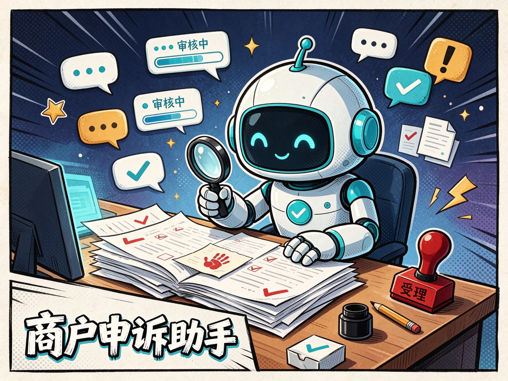

<p align="center"></p>

# Merchant Appeal — 商户申诉智能助手

面向微信/支付违规申诉场景的多轮对话收集、AI 诊断、材料清单与智能商城；管理后台集成 **AI 进化**、**AI 中枢**、**AI 管理助手**。

## 功能概览

| 模块 | 说明 |
|------|------|
| 用户对话 | `ChatPage` — 流式对话、信息收集、申诉文案 |
| AI 进化 | 对话分析 → 规则库 → 注入 System Prompt（见 [docs/AI_EVOLUTION.md](docs/AI_EVOLUTION.md)） |
| 管理端 AI 助手 | 右下角 FAB：计划预览、确认执行、设置/充值/用户等工具 |
| AI 模型 / 中枢 | 模型健康、Key 导入、自然语言运维指令 |
| 闲鱼管家 | 订单发货、改价（需配置 API Key） |

## 技术栈

- **前端**：React 18 + Vite + Tailwind  
- **后端**：Node.js + Express + MySQL  
- **AI**：多厂商 OpenAI 兼容 API，自动 fallback  

## 快速开始

```bash
cp .env.example .env
# 配置 MySQL、JWT_SECRET、DEEPSEEK_API_KEY 等

npm install
npm run dev
```

- 用户端：Vite 开发服务器（默认代理 `/api` → `localhost:3001`）  
- 管理端：`/admin`  

## 验证

```bash
npm run test:unit
npm run verify:all
```

| 脚本 | 作用 |
|------|------|
| `verify:evolution` | AI 进化链路（Key、批量分析、Prompt 注入） |
| `verify:agent` | 管理端 Agent 冒烟（plan/execute/token） |

## 开发规范

本项目强制 **Cursor Superpowers** 全流程，详见：

- [AGENTS.md](AGENTS.md)
- [docs/DEVELOPMENT_WORKFLOW.md](docs/DEVELOPMENT_WORKFLOW.md)

## 目录结构（摘要）

```
server/
  index.js          # 入口，启动 evolution 定时器
  createApp.js      # Express 应用工厂
  app/registerRoutes.js
  evolution.js      # AI 自进化引擎
  ai.js             # 用户对话 AI + Prompt
  ai/adminAgent.js  # 管理端 Agent
src/
  pages/ChatPage.jsx
  pages/AdminPage.jsx
  components/admin/AdminAIFab.jsx
  components/EvolutionPanel.jsx
docs/
  AI_EVOLUTION.md
  superpowers/      # 设计与实施计划
```

## License

Private — 部署与开源策略以仓库所有者为准。
